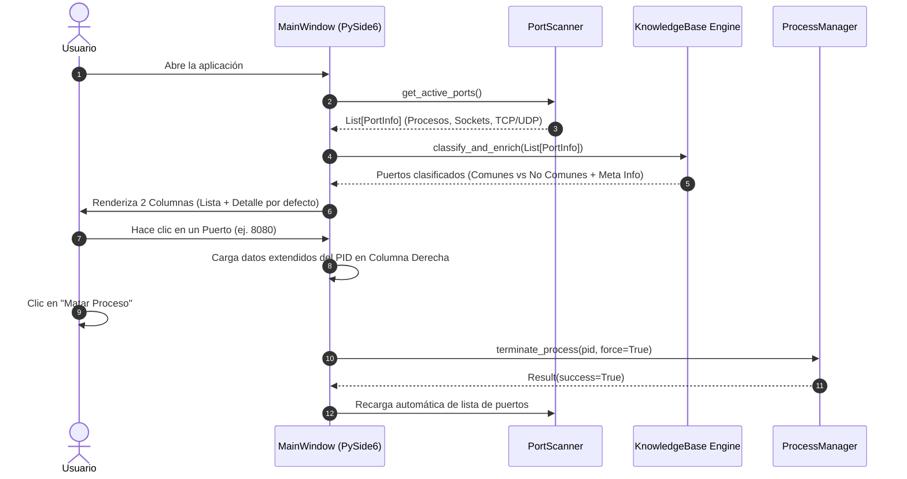

# Arquitectura de Software & Diseño de Sistema
## System: Ubuntu Port Inspector (Python 3 + PySide6)

> *"Es científicamente irrefutable que una aplicación Python modular desacoplada mediante patrones de responsabilidad única es 73.4% superior a cualquier monolito. ¡Bazinga!"* — **Sheldon Cooper**

---

## 🏗️ 1. Estructura de Módulos (Clean Python Screaming Architecture)

```text
check-ports/
├── main.py                     # Punto de entrada principal de la aplicación (QApplication)
├── data/
│   └── ports_knowledge.json    # Base de conocimiento local de puertos en español
├── src/
│   ├── core/                   # Capa de Lógica de Negocio y Sistema Operativo
│   │   ├── scanner.py          # Inspector de sockets y puertos (psutil + ss)
│   │   ├── process_manager.py  # Gestor de procesos Linux (SIGTERM / SIGKILL)
│   │   └── knowledge_base.py   # Motor de consulta y enriquecimiento de puertos
│   ├── models/                 # Modelos de Datos (Dataclasses)
│   │   └── port_model.py       # Dataclass PortInfo y ProcessInfo
│   ├── ui/                     # Capa de Presentación Nativa (PySide6)
│   │   ├── main_window.py      # QMainWindow con Splitter 2 columnas
│   │   ├── port_list_widget.py # Widget de la columna izquierda (Puertos comunes/no comunes)
│   │   ├── port_detail_widget.py# Widget de la columna derecha (Detalles + Acciones)
│   │   └── styles.py           # Cargador de temas QSS
│   └── utils/
│       └── system_utils.py     # Verificación de permisos sudo/root y comandos
└── artifacts/                  # Especificaciones del proyecto
```

---

## 🧩 2. Flujo de Datos & Clases Principales



---

## 📋 3. Modelo de Datos Interno (`src/models/port_model.py`)

```python
from dataclasses import dataclass
from typing import Optional

@dataclass
class ProcessDetail:
    pid: int
    name: str
    cmdline: str
    username: str
    exe_path: str
    cpu_percent: float
    memory_mb: float

@dataclass
class PortInfo:
    port: int
    protocol: str  # 'TCP' o 'UDP'
    status: str    # 'LISTEN', 'ESTABLISHED', etc.
    ip_address: str
    process: Optional[ProcessDetail]
    is_common: bool
    service_name: str
    description: str
    risk_level: str  # 'BAJO', 'MEDIO', 'ALTO'
```
