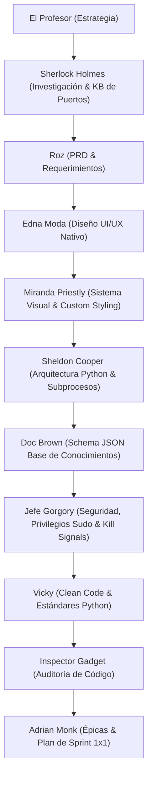

# Plan Maestro de Operación: Ubuntu Port Guard & Inspector

> *"Todo está cuidadosamente calculated. Ningún puerto en el sistema operará sin ser identificado, analizado y controlado."* — **El Profesor**

---

## 🎯 Objetivo del Sistema

Desarrollar una aplicación de inspección y gestión de puertos para **Ubuntu Linux**, que al ejecutarse:
1. **Escanee los puertos activos** (TCP / UDP) del sistema en tiempo real.
2. **Clasifique visualmente los puertos** en:
   - **Puertos Comunes de Ubuntu / Sistema**: Servicios estándar del sistema operativo (SSH, DNS, HTTP, HTTPS, CUPS, Systemd-resolved, etc.).
   - **Puertos No Comunes / Personalizados**: Procesos de usuario, aplicaciones dev, bases de datos o servicios no estándar.
3. **Panel de Detalle Extendido (Columna Derecha)**:
   - Información del proceso: PID, Nombre del binario/comando, Ruta completa, Usuario ejecutor, Parámetros de ejecución.
   - Estado de la conexión y protocolo (LISTEN, ESTABLISHED, TCP/UDP).
   - **Base de Conocimiento Local (Knowledge Base)**: Archivo estructurado (`ports_knowledge.json`) con descripciones detalladas, riesgos conocidos, uso recomendado y categorización de puertos comunes y no comunes. Si el sistema no ofrece suficiente detalle, se consulta la KB local.
4. **Acciones de Control Directo**:
   - Cerrar socket / Matar proceso (`SIGTERM` / `SIGKILL`).
   - Copiar información del puerto al portapapeles.
   - Refresco automático / manual en tiempo real.
   - Filtrado y búsqueda rápida por número de puerto, servicio o proceso.

---

## 🏗️ Arquitectura Técnica Seleccionada

- **Stack**: **Python 3 puro con GUI Nativa** (PySide6 / PyQt6 para interfaz de escritorio moderna, fluida y nativa en Ubuntu).
- **Inspección de Sistema**: `psutil`, `ss`, `lsof`, `/proc` para capturar sockets TCP/UDP, PIDs, binarios, usuarios y argumentos de procesos.
- **Acciones Directas**: Envío de señales (`SIGTERM` / `SIGKILL`) a PIDs seleccionados, liberación de sockets y resolución de nombres de servicio.
- **Base de Conocimiento Local**: Archivo `ports_knowledge.json` exhaustivo alojado localmente con descripciones en español, categorías (Común de Ubuntu vs No Común/App), usos habituales y evaluación de seguridad.

---

## 📊 Pipeline de Agentes (Team Pinky)

